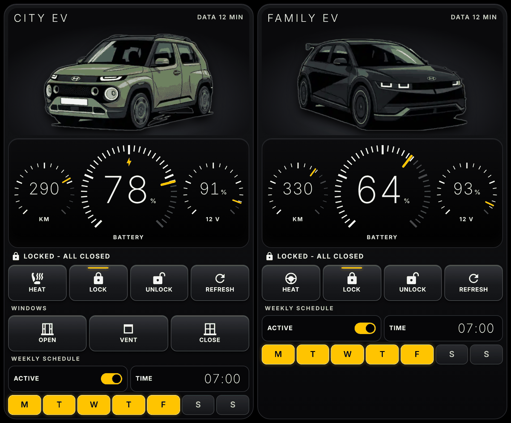

# Luce Garage Card



Card Lovelace compatta in stile strumentazione per auto elettriche: quadranti analogici per batteria, autonomia e 12 V, tasti fisici, stato di porte e finestrini e programmazione settimanale. Le auto restano affiancate anche col telefono in verticale.

Pensata per l'integrazione [Kia Uvo / Hyundai Bluelink](https://github.com/Hyundai-Kia-Connect/kia_uvo). Un solo file JavaScript, nessuna dipendenza, italiano e inglese. Tutte le opzioni sono nel [README inglese](README.md).

> Progetto non ufficiale, senza legami con Ferrari, Hyundai, Kia o altri costruttori. Le integrazioni delle auto usano API non ufficiali che possono smettere di funzionare. I comandi remoti agiscono su un'auto vera: usali con attenzione.

## Installazione

**HACS:** aggiungi questo repository come repository personalizzato, categoria **Dashboard**, scarica **Luce Garage Card**, poi chiudi del tutto l'app Home Assistant e riaprila.

Se subito dopo compare "Errore di configurazione", l'interfaccia non ha ancora caricato il file: chiudi completamente l'app e riaprila.

## Configurazione

Se le entità hanno i nomi italiani di `kia_uvo`, ad esempio `sensor.mia_auto_livello_batteria_ev`:

```yaml
type: custom:luce-garage-card
cars:
  - name: La mia auto
    prefix: mia_auto
    schedule_id: mia_auto
    image: /local/mia_auto.webp   # facoltativa, meglio con sfondo trasparente
    max_range: 500
    entities:
      heat: script.mia_auto_heat
```

Un tasto o una sezione spariscono se la relativa entità non esiste. Per occupare tutta la pagina usa una vista di tipo *panel*.

## Riscaldamento e programmazione

[`luce_garage.yaml`](luce_garage.yaml) crea helper, script e automazione per un'auto. Sostituisci `my_ev` con il tuo identificativo (anche nello `schedule_id`) e `REPLACE_WITH_DEVICE_ID`, che trovi nell'indirizzo della pagina del dispositivo. Le opzioni di riscaldamento cambiano da modello a modello: provale con l'auto vicina. La programmazione parte spenta.

Scalda, Sblocca, Aggiorna, Apri e Socchiudi richiedono due tocchi: il primo arma il tasto per 3 secondi, il secondo invia il comando.

## Licenza

MIT
