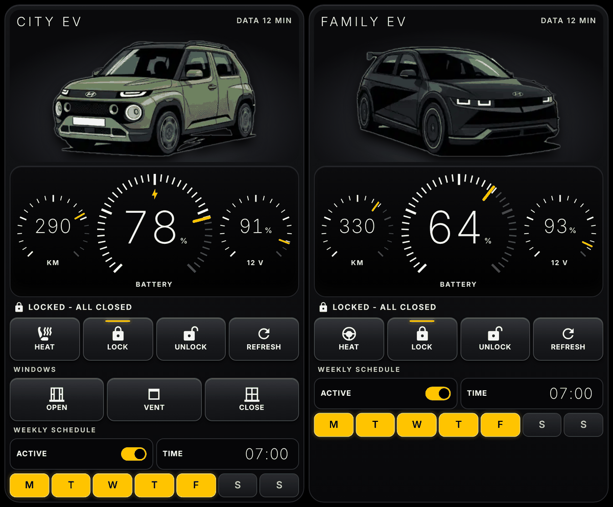

# Luce Garage Card



A compact, instrument-style Lovelace card for electric cars: analog-looking dials for battery, range and 12 V, hardware-style keys, door and window status, and a weekly schedule. Cars stay side by side even on a phone in portrait.

Built for the [Kia Uvo / Hyundai Bluelink](https://github.com/Hyundai-Kia-Connect/kia_uvo) integration, but every entity is configurable, so it can work with other car integrations. Single JavaScript file, no dependencies. Italian and English.

> Unofficial project, not affiliated with or endorsed by Ferrari, Hyundai, Kia or any other manufacturer. Car integrations rely on unofficial APIs that can stop working. Remote commands act on a real vehicle: use them responsibly.

## Install

**HACS:** add this repository as a custom repository, category **Dashboard**, download **Luce Garage Card**, then fully close and reopen the Home Assistant app (or hard-refresh the browser).

**Manual:** copy `luce-garage-card.js` to `/config/www/`, add the dashboard resource `/local/luce-garage-card.js` of type *JavaScript module*, then fully reload the frontend.

If the card shows "Configuration error" right after installing, the frontend has not loaded the new file yet: close the app completely and reopen it.

## Minimal configuration

```yaml
type: custom:luce-garage-card
language: en   # it or en; defaults to your Home Assistant language
cars:
  - name: My EV
    image: /local/my_ev.webp   # optional, a transparent image looks best
    max_range: 500             # full scale of the range dial
    heat_icon: mdi:steering    # optional
    schedule_id: my_ev         # optional, see the example package
    entities:
      battery: sensor.my_ev_ev_battery_level
      range: sensor.my_ev_ev_range
      aux_battery: sensor.my_ev_car_battery_level
      updated: sensor.my_ev_last_updated_at
      charging: binary_sensor.my_ev_ev_battery_charge
      climate: binary_sensor.my_ev_air_conditioner
      lock: lock.my_ev_door_lock
      heat: script.my_ev_heat
      refresh: button.my_ev_force_update
      doors:
        - { entity: binary_sensor.my_ev_front_left_door, name: Front L }
        - { entity: binary_sensor.my_ev_front_right_door, name: Front R }
```

The entity ids above are examples: `kia_uvo` names them according to your language and car, so copy yours from **Settings > Devices & services**. A key or section is hidden when its entity does not exist.

### Italian shortcut

If your entities use the Italian names created by `kia_uvo`, set `prefix` and the card fills in almost everything. With entities such as `sensor.my_ev_livello_batteria_ev`:

```yaml
cars:
  - name: La mia auto
    prefix: my_ev
    schedule_id: my_ev
    entities:
      heat: script.my_ev_heat
```

## Options

| Car option | Description |
| --- | --- |
| `name` | Required. Label on the card |
| `image` | Optional image URL; a neutral icon is used otherwise |
| `prefix` | Italian entity-name shortcut |
| `max_range` | Full scale of the range dial, default 600 |
| `heat_icon` | Icon of the heat key |
| `schedule_id` | Uses the helpers created by the example package |
| `schedule` | Alternative to `schedule_id`: `enabled`, `time`, and `days` (7 entities, Monday first) |
| `entities` | `battery`, `range`, `aux_battery`, `updated`, `charging`, `climate`, `lock`, `heat`, `refresh`, `windows_open`, `windows_vent`, `windows_close`, `doors`, `windows` |

Card options: `language` and `columns` (default 2). For a full-page layout use a *panel* view, as in [`dashboard.yaml`](dashboard.yaml).

## Heating script and weekly schedule

[`luce_garage.yaml`](luce_garage.yaml) creates the helpers, a heating script and the automation for one car. Replace `my_ev` and `REPLACE_WITH_DEVICE_ID`; you find the device id in the URL of the car's device page. Heating options vary by model, so test them with the car nearby. The schedule starts switched off.

Heat, Unlock, Refresh, Open and Vent need two taps: the first arms the key for 3 seconds, the second sends the command. Refreshing wakes the car and uses some 12 V battery.

## License

MIT
